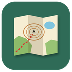

# LoriMaps

LoriMaps ist eine schlanke Android-Karten-App mit GPS-Standort für Wanderungen und Touren.
Dies ist die neue Version auf Basis von **MapLibre Native**: Der Kartenrenderer kann Vektorkarten
(und weiterhin Rasterkarten) darstellen. Die Vorgängerin mit osmdroid liegt in
[osmv-offline](https://github.com/lorenzdenk/osmv-offline).

## Stand

Die App läuft mit MapLibre, zeigt die bisherigen **Online-Karten** und **Offline-Karten** – Vektorkarten von
[lorimaps-vector-render](https://github.com/lorenzdenk/lorimaps-vector-render) und Rasterkarten (MBTiles).

| Funktion | Stand |
|---|---|
| Online-Karten OpenTopoMap, OpenCycleMap (Thunderforest-Schlüssel), CyclOSM | übernommen (Raster) |
| Vektorkarte OpenFreeMap | neu, als Beispiel für eine Vektorkarte |
| Overlays Waymarked Trails (Wandern, Velo), Reihenfolge und Deckkraft | übernommen |
| GPS-Standort mit Genauigkeitskreis und Kompass-Kegel, Verfolgen, Sprung hin und zurück | übernommen |
| Zoom in ganzen Stufen (Knöpfe und Finger), Stufenanzeige, Kartengrösse | übernommen |
| Massstab, Lineal, Pins, Koordinatensuche, Richtungspfeil am Rand, `geo:`-Links | übernommen |
| Offline-Vektorkarten (lorimaps-vector-render): importieren oder direkt aus dem neuesten Release herunterladen | neu |
| Offline-Rasterkarten und -Overlays (MBTiles, auch in mehreren Teilen), löschen | übernommen |
| GPX-Overlays | **noch nicht** |
| Einstellung „Beim Zoomen mit zwei Fingern“ | entfällt (MapLibre zeigt zwischen zwei Stufen die nähere) |

## Installieren

Jeder Push auf `main` baut die App per GitHub Actions. Die fertige APK liegt unter
[Releases](../../releases) (`build-N`). Alle Builds sind mit demselben Schlüssel signiert und lassen sich
als Update über eine vorhandene Installation installieren. Die App hat eine eigene Paket-ID
(`io.github.lorenzdenk.lorimaps`) und lässt sich neben der bisherigen App installieren.

## Selbst bauen

`gradle assembleDebug` mit Gradle 8.13 und Java 17 (oder den Ordner in Android Studio öffnen);
die APK liegt danach in `app/build/outputs/apk/debug/`.

## Offline-Karten

Kartenmenü → *Offline-Karte herunterladen* zeigt die Karten des neuesten Releases von lorimaps-vector-render;
der Download läuft im Hintergrund (Android-Downloadmanager), danach erscheint die Karte unter *Offline-Karten*.
Oder Dateien mit *Kartendateien importieren* auswählen bzw. per USB in den Ordner `Android/data/io.github.lorenzdenk.lorimaps/files/maps`
kopieren. Eine Vektorkarte besteht aus `<name>-vector.mbtiles` und `<name>-style.zip` (Stil, Symbole, Schriften),
dazu wahlweise `<name>-hillshade.mbtiles` und `<name>-relief.mbtiles`. Die App entpackt den Stil und lenkt seine
Platzhalter `lorimaps://…` auf die Dateien (`mbtiles://`, `file://`, von MapLibre selbst gelesen – kein Internet nötig).
Rasterkarten sind einzelne `.mbtiles`-Dateien; solche mit `type = overlay` erscheinen in der Overlay-Liste.

## Code-Übersicht

- `MainActivity.java` – Karte (MapLibre), Knöpfe, Zoomstufen, Standort, Lineal
- `MapsCatalog.java`, `MapSource.java` – Karten und Overlays, Kartenmenü, Overlay-Liste, Download-Auswahl
- `OfflineMaps.java` – Offline-Karten: Ordner lesen, Stilpaket entpacken und auf die Dateien umschreiben, Import, Download, Löschen
- `MapOverlayView.java` – durchsichtige Ansicht über der Karte, auf die die App selbst zeichnet
- `LocationMarker.java` – Standort (GPS/Netz), Kompass, Standortpunkt
- `PinManager.java`, `CoordinateParser.java` – Pins und Koordinatensuche
- `ScaleBarView.java` – Massstab

### Zoomstufen

Die App rechnet in Stufen wie in OpenStreetMap-Kachel-URLs. MapLibres Zoom 0 zeigt die Welt 512 Einheiten
breit; eine Rasterquelle mit Kachelgrösse T zeigt Stufe n bei Zoom n + log2(T / 512) genau in T Einheiten
pro Kachel. Die App setzt T (164 bei Kartengrösse 100 %) und lässt die Karte immer auf einer ganzen Stufe
einrasten – so bleiben Rasterkarten scharf.

## Herkunft und Lizenz

Oberfläche und Bedienung stammen aus der Open-Source-App „Simple OSM Viewer“ (OSMv). Lizenz: MIT,
siehe [LICENSE](LICENSE). Kartenrenderer: MapLibre Native (BSD, 2 Klauseln).

Kartendaten © OpenStreetMap-Mitwirkende. Für die Online-Karten gelten die Bedingungen des jeweiligen Anbieters.
